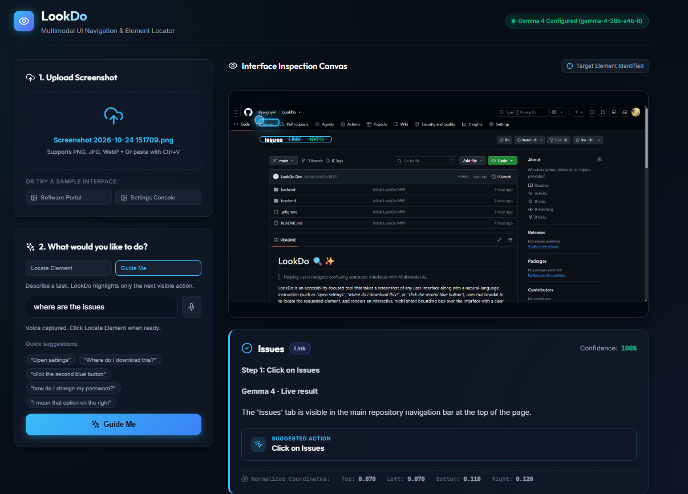
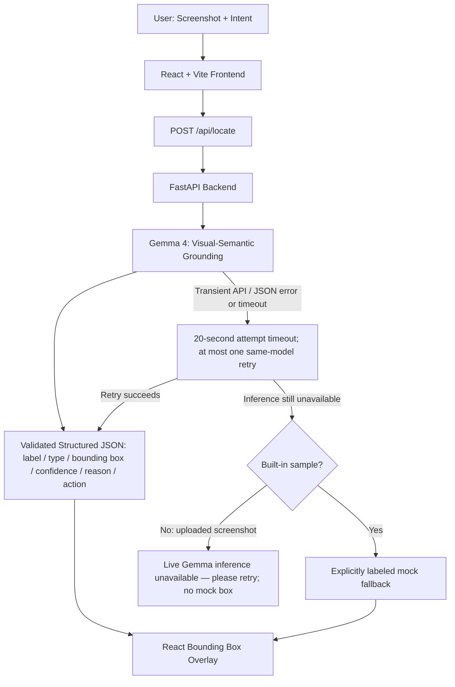

# LookDo 👁️

### Multimodal UI Navigation & Element Locator

LookDo uses Gemma 4 to understand a user interface screenshot together with natural-language intent, identify the UI element the user means, and visually highlight it.

**Tell LookDo what you want to do. It finds where to do it.**

## Real-World Live Demo



This successful run used a **real GitHub repository page**, not a built-in LookDo sample.

| Demonstrated flow | Observed result |
| --- | --- |
| Interface | Real LookDo GitHub repository page |
| Input | Voice, captured as text with browser SpeechRecognition |
| Mode / user intent | Guide Me / “Where are the issues?” |
| Model / source | **Gemma 4 live inference — not fallback** |
| Target | Correctly identified the visible **Issues** tab (link) |
| Confidence shown by the app | **100%** for this run; not a claim of perfect accuracy |
| Next step returned | **Click on Issues**, displayed as “Step 1: Click on Issues” |
| Highlight | Target highlighted using normalized bounding-box coordinates |

Gemma 4 combined the screenshot and recognized intent to perform visual-semantic grounding. The returned box was left `0.070`, top `0.070`, right `0.120`, bottom `0.110`. This is an observed successful demo, not a guarantee of future accuracy or endpoint availability.

## Problem

Modern interfaces can be visually dense and difficult to navigate, especially for users who do not know where an action is located or find precise navigation difficult.

## Solution

The user provides:

- A screenshot
- Natural-language intent, typed or spoken

For example:

- “Open settings”
- “Where do I download this?”
- “How do I change my password?”

LookDo uses multimodal AI to ground that intent to a visible interface element and highlights the result, with a reason and suggested action.

## Feature status

**Implemented**

- Screenshot upload/paste
- Natural-language intent
- Voice intent capture
- Locate Element mode
- Guide Me mode — one next visible action, without conversation memory
- Gemma 4 multimodal visual-semantic grounding
- Experimental rough Attention Context using LEFT / CENTER / RIGHT head direction
- Normalized bounding-box highlighting
- Structured explanation
- Timeout/retry handling
- Transparent fallback for built-in samples

Browser `SpeechRecognition` (including Chromium's `webkitSpeechRecognition` prefix) converts speech into the existing intent field. Voice is an input method, not the AI reasoning layer: **Gemma 4 still performs the multimodal visual-semantic grounding**. Typed input remains supported. Recognition never submits automatically; review the text and click **Locate Element** or **Guide Me**. Unsupported browsers retain typed input, and microphone or recognition errors are shown without blocking typing.

### Input and reasoning roles

- **Voice** = browser SpeechRecognition capturing intent as text; typed input remains supported.
- **Gemma 4** = multimodal reasoning and visual-semantic grounding using the screenshot and intent together.
- **Attention Context** = an optional, experimental LEFT / CENTER / RIGHT spatial signal from rough head direction, **not precise eye tracking**. It provides extra evidence for Locate mode only and does not change Guide Me semantics. Camera/model failure leaves the normal text/voice flow available.

## Architecture



The backend sends image and instruction together, validates the returned structure, and normalizes the result for rendering. The UI has a 50-second loading deadline. Retries never switch models. Non-retryable API failures go directly to the same sample-only fallback/error decision.

## Why Gemma 4?

Gemma is not used merely to generate text. It receives:

- The screenshot
- The user's natural-language intent

Its role is **visual-semantic grounding**: understanding which visible UI element best matches what the user means and locating it within the screenshot. The frontend only renders the structured result returned by the backend.

The judging/demo model configuration is **`gemma-4-26b-a4b-it`**, selected with `LOOKDO_GEMMA_MODEL` in the launch instructions below. The repository's unchanged code default is `gemma-4-31b-it` if no override is set. LookDo uses Google's hosted API for the open-weight Gemma family; it does not run the model weights locally.

## Structured output

Conceptual result example:

```json
{
  "label": "Settings",
  "element_type": "button",
  "bounding_box": {
    "left": 0.88,
    "top": 0.03,
    "right": 0.96,
    "bottom": 0.08
  },
  "confidence": 0.94,
  "reason": "The Settings button matches the requested action.",
  "suggested_action": "Open Settings"
}
```

Coordinates are normalized from 0 to 1 so overlays remain aligned when screenshots are resized. The existing API uses `element_label` for `label` and `explanation` for `reason`, adds computed box `width`/`height`, and includes a `source` field (`gemma`, `mock`, or the legacy optional `gemini` provider). The result card explicitly identifies live Gemma versus mock/fallback coordinates. Confidence is a model estimate, not a calibrated probability.

## Tech stack

| Area | Technologies / safeguards |
| --- | --- |
| Frontend | React, Vite |
| Backend | Python, FastAPI, Pydantic, Pillow |
| AI | Gemma 4, Google GenAI SDK |
| Reliability | Request timeout, bounded retry, validated structured output, transparent fallback for built-in samples |

## How it works

1. **See** — upload/paste an interface screenshot.
2. **Ask** — type your intent, or click the microphone and speak; review the text before submitting.
3. **Understand** — Gemma 4 combines visual and language context.
4. **Locate** — LookDo highlights the intended element.

## Guide Me

Guide Me identifies only the **next visible action** toward a task on the current screenshot. It returns a single `next_step` (displayed as **Step 1**), a target label/type, normalized bounding box, confidence, and a short instruction. It shares Locate mode's screenshot pipeline and overlay, without conversation memory or multi-step state.

Featured example:

```text
Voice → "Where are the issues?"
Screenshot → real LookDo GitHub repository page
Gemma 4 → identifies the Issues tab
LookDo → highlights Issues and returns Step 1: Click on Issues
```

## Demo

**Primary demo:** select **Software Portal**, use **“Open settings”**, and click **Locate Element**. Show the highlight and the result-source label.

**Secondary demo:** on the same sample, ask **“Where do I download this?”**.

**Voice demo:** click the microphone beside the intent field, allow microphone access, say **“Open settings”**, review the recognized text, then click **Locate Element**. Browser recognition availability varies; typed input always remains available.

The second built-in sample, **Settings Console**, remains available with its password-change example. Uploaded real-world screenshots are also supported through upload, drag-and-drop, or Ctrl+V paste. If live inference fails for an upload, LookDo shows a retry message and draws no predefined mock box. Built-in samples alone can use labeled mock fallback.

### Run locally

Prerequisites: Python 3.10+ and Node.js 18+. From the repository root, start the backend in PowerShell:

```powershell
cd backend
python -m pip install -r requirements.txt
# First-time setup only: copy .env.example to .env if .env does not exist.
# Put your own GEMINI_API_KEY in backend/.env. Never commit the key.
$env:LOOKDO_AI_PROVIDER="gemma"
$env:LOOKDO_GEMMA_MODEL="gemma-4-26b-a4b-it"
python -m uvicorn app.main:app --port 8000
```

In a second terminal from the repository root:

```powershell
cd frontend
npm install
npm run dev
```

Open [LookDo](http://localhost:5173). Dependencies only need installing on first setup or when they change. API documentation is available at [FastAPI docs](http://localhost:8000/docs).

For an intentional offline demonstration of the built-in samples, set `LOOKDO_AI_PROVIDER=mock` before starting the backend. The header shows the configured provider; the result card reports the actual result source.

### Offline validation

These commands do not send Gemma API requests:

```powershell
# From the repository root:
python -m compileall -q backend/app
cd backend
python -m unittest test_demo_reliability
cd ../frontend
npm run build
```

`test_demo_reliability.py` covers both demo commands, same-model retry limits, timeout enforcement, and sample-only mock responses. The other retained tests are manual/live integration checks; do not run them as part of offline validation.

## Reliability / External Model Availability

LookDo has bounded timeout and retry handling. The **external Gemma inference endpoint** can occasionally return transient timeouts, HTTP 503 responses, or other server errors. These external availability failures do not by themselves indicate a LookDo application defect; model availability is not guaranteed.

LookDo exposes unsuccessful inference honestly rather than presenting it as successful live AI output. For uploaded real-world screenshots it shows a retry state without a predefined mock box. Built-in sample fallback is **explicitly labeled** when used.

## Current limitations

- Dense interfaces and very small controls can reduce grounding accuracy, especially after the backend resizes images to a maximum 400-pixel edge.
- Model latency and availability can vary; hosted inference requires internet access and quota.
- The MVP identifies and highlights targets but does not automatically click them.
- Mock fallback is explicitly labeled and intended only for built-in demos; its predefined coordinates do not analyze the screenshot.
- Accessibility benefits need broader usability validation.

## Roadmap — FUTURE WORK

These are planned concepts, **not implemented features**:

- Extended step-by-step guidance beyond the implemented single-step Guide Me mode
- Improved gaze/spatial context beyond the experimental rough head-direction signal
- Combine gaze + speech: look toward something and say “open that”
- DOM/OCR-assisted grounding for higher coordinate precision
- Browser action execution / optional browser extension

## Judging visual

Open [pitch.html](pitch.html) directly from your local checkout for a one-page technical overview. It uses inline HTML/CSS, with no dependencies or network assets.

## Open source

LookDo is released under the [MIT License](LICENSE). The application license does not relicense Gemma model weights or the hosted API; their respective terms apply.

## Security

- `.env` files are ignored by Git. `.env.example` is a configuration template without credentials.
- Keep API keys in the backend environment; never place them in frontend code, test fixtures, or documentation.
- Screenshots are sent to the hosted model provider. Avoid uploading sensitive content.
